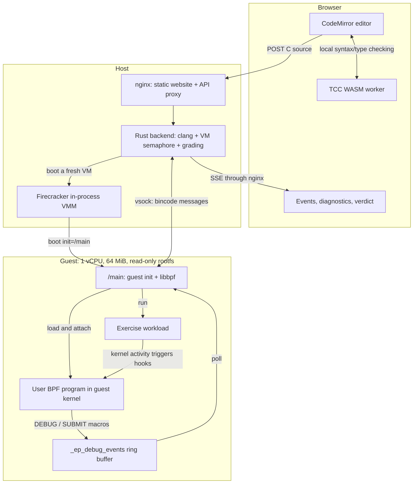
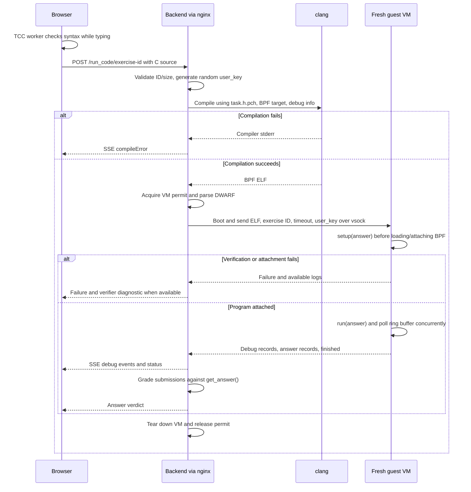

# BPFLab

**BPFLab** (formerly eBPF.party) is a Persian-language, interactive eBPF tutorial. You write C in a browser, observe real Linux kernel activity inside a disposable Firecracker microVM, and submit the result of an exercise. This repository contains the learning website, tutorial content, host backend, guest runtime, kernel patch, build tools, and a separate blog at **<https://blog.bpflab.ir>**.

The website and blog use Persian RTL layouts; the editor, code, identifiers, and compiler/verifier output stay LTR. No local eBPF toolchain is needed to use a deployed instance.

[Quick start](#quick-start) · [Architecture](#architecture) · [Execution workflow](#execution-workflow) · [Repository structure](#repository-structure) · [Exercises and sample code](#exercises-and-sample-code) · [Local development](#local-development) · [API and configuration](#api-and-configuration) · [Contributor workflow](#contributor-workflow) · [Testing and troubleshooting](#testing-and-troubleshooting) · [Blog](#blog)

## Quick start

Run commands from the repository root unless a command explicitly changes directories.

```bash
docker compose up --build web   # website only: http://localhost:8080
docker compose up --build       # website + code execution + blog
```

Choose one mode. Website-only mode needs Docker but not KVM; execution is unavailable and `/run_code/` and `/metrics` return 502 until the backend is running. Nginx resolves the optional backend at request time, so its absence does not prevent startup.

Full-stack mode requires an **x86-64 Linux host with usable `/dev/kvm`**, including nested virtualization if the host is itself a VM. Compose runs the backend privileged; its entrypoint allocates the required hugepages at startup. The first build is substantial: it compiles a patched Linux kernel, Rust binaries, a guest rootfs, and browser WASM artifacts. The web service publishes `8080` and reaches the backend through nginx; the backend publishes `127.0.0.1:8081` only, so the Astro dev server on the host can use the containerized backend.

Open `/exercises/`, select an exercise, read its instructions, edit its starter C program, and run it. Inspect debug events or diagnostics, then submit the requested value through a `SUBMIT_*` macro. Code, editor settings, and progress are stored locally in your browser; unavailable or corrupt storage does not block editing.

The `blog` service builds and tests the Jekyll site and serves it at <http://localhost:4000>; run it alone with `docker compose up --build blog`.

## Architecture

| Component    | Technology and responsibility                                                                                                                               |
| ------------ | ----------------------------------------------------------------------------------------------------------------------------------------------------------- |
| `website/`   | Astro 7, React 19, Tailwind 4, TypeScript, CodeMirror, pnpm. Static pages plus interactive editors and visualizations.                                      |
| `tcc/`       | TinyCC fork, built with Emscripten to WASM; syntax/type checking runs in a browser worker.                                                                  |
| `backend/`   | Rust HTTP server using `touche`, threads, and channels rather than an async runtime; compiles source, manages VM capacity, streams results, grades answers. |
| `userspace/` | Static Rust/musl guest init with libbpf; sets up the guest, attaches BPF programs, runs workloads, polls the debug ring buffer.                             |
| `shared/`    | Exercise IDs, expected-answer generation, and bincode-encoded host/guest messages over vsock.                                                               |
| `blog/`      | Independent Jekyll 4 site with its own static Compose service; not part of the execution stack.                                                             |



The VM has no external network interface; networking exercises use guest loopback. Its read-only disk contains `/main`, `/true`, and `/exit_with_code`; guest setup mounts writable ramfs at `/bin` and `/tmp`. The VM pool is a **concurrency semaphore**, not a pool of reused guests: each compiled submission gets a fresh VM when capacity is available.

Firecracker runs inside the backend process through the patched `firecracker-spawn` dependency. The container also installs upstream `firecracker` and `jailer` release binaries for compatibility/debugging; they are not the normal request execution path. VM isolation is not a complete production security policy: the backend also invokes clang on submitted source on the host, and Compose grants broad privileges. Review access controls, resource limits, and deployment isolation before exposing a public instance.

## Execution workflow



1. **Edit locally:** `website/src/workers/tcc-worker.ts` loads WASM TCC and emits errors/type information without a server round trip. TCC is advisory; clang and the guest kernel verifier decide whether a program can actually run.
2. **Compile on the host:** `backend/src/main.rs` accepts raw C up to 16 KiB. `compile.rs` invokes clang with `-O2 -target bpf -D__TARGET_ARCH_x86` and debug information. At server startup, clang builds `task.h.pch` from the supplied kernel types.
3. **Run in a fresh guest:** `vm_pool.rs` waits up to 2 seconds for capacity, boots a 1-vCPU/64-MiB VM using hugepages, and communicates over vsock port 1234. The host sends `HostMessage::ExecuteProgram { exercise_id, timeout, program, user_key }`; the configured exercise execution window is 500 ms, not an end-to-end HTTP deadline.
4. **Generate observable activity:** `/main` mounts sysfs/tracefs, enables loopback, derives the answer, and calls `setup()` **before** attaching programs. `run()` then triggers the file, process, or network activity to inspect. libbpf verifies/loads the ELF and automatically attaches its programs.
5. **Return and grade:** macros write typed records to `_ep_debug_events`; the guest polls them and sends `GuestMessage::Event`. The backend forwards debug records and consumes answer records. Zero submissions produce `noAnswer`, one is compared to the expected bytes, and multiple produce `multipleAnswers`. String comparisons trim trailing NULs; execution failures suppress answer grading. The VM is torn down and capacity is released.

**Streaming:** the browser uses `fetch()` to read a POST response, not native `EventSource`. HTTP responses use SSE framing, with camelCase JSON in `data:` lines. Progress records are queued during processing; the current handler returns the response after compilation/VM handling, so these labels do not guarantee immediate live delivery of each phase.

### Verifier diagnostics

[`verifier-provenance.patch`](verifier-provenance.patch) extends Linux 6.18.2 verifier failures with `DIAG1` provenance records describing register origins and checks. `backend/src/diag.rs` combines these records, BTF instruction-to-source line information, DWARF, and the submitted C to render rustc-style annotated errors. The original verifier log remains a fallback; internal `DIAG1` lines are stripped before display. Unsupported diagnoses are saved in `missing_diagnostic/` relative to the backend's working directory for future fixtures. Guest verifier buffers are capped at 32 KiB per program, retaining the tail when truncated.

## Repository structure

```text
bpf.party/
├── website/
│   ├── src/       # components, layouts, pages, workers, types, styles
│   │              # exercises-metadata.ts: routes; content/exercises/: MDX
│   └── public/    # exercises-code/<number>/*.c, TCC WASM/data, assets
├── blog/          # _posts, _layouts, _includes, _sass, assets, tests
├── backend/
│   ├── src/       # main, compile, vm_pool, guest_message, metrics, config
│   ├── includes/  # ep_platform.h, task.h, tracepoint types, BPF headers
│   └── tests/     # diagnostic fixtures/goldens and DWARF regression test
├── userspace/src/ # guest init, ebpf loader, exercises, mount/network setup
├── shared/src/    # protocol, ExerciseId, get_answer()
├── bins/          # tiny nolibc workload binaries
├── tcc/           # TinyCC git submodule; em_include → backend/includes
├── docker/        # Dockerfiles, nginx.conf, config, kernel fragment, artifacts
├── scripts/       # TCC/kernel/backend builds, Firecracker setup, nginx smoke test
├── Makefile       # website/blog commands, PCH/WASM/rootfs build rules
└── docker-compose.yml, verifier-provenance.patch
```

The Rust crates are separate Cargo projects, **not a workspace**, with separate lockfiles. `firecracker/` and `firecracker-spawn/` are generated, gitignored dependencies prepared by `scripts/setup-firecracker-spawn.sh`. Generated outputs include `website/dist/`, `blog/_site/`, `rootfs.ext4`, `docker/artifacts/`, and TCC's `.mjs`, `.wasm`, and `.data` files.

## Exercises and sample code

`shared::get_answer(exercise_id, user_key)` is used by both host and guest. Most answers vary with a random per-request `u64`; introductory/buffer exercises have fixed answers. `Exercise::setup(answer)` plants data before BPF attachment, while `Exercise::run(answer)` creates the activity learners must observe.

| Published chapter | Exercises / concepts                                                                                                                                                    |
| ----------------- | ----------------------------------------------------------------------------------------------------------------------------------------------------------------------- |
| 0: Introduction   | Theory (no editor), `platform-overview`: platform macros and a fixed answer.                                                                                            |
| 1: Concepts       | `concept-intro`, `reading-event-data`, `reading-syscalls`, `read-argv-password`: process names, tracepoint contexts, syscall arguments, pointer arrays.                 |
| 2: Stateful eBPF  | `intro-maps-and-programs`, `read-buffer-contents`, `read-file-password`, `socket-and-connect`: maps, buffers, cross-syscall state, successful connections among decoys. |
| 3: Kernel kprobes | `tcp-connect`, `read-http-password`: TCP connection state and a bearer token in guest-local HTTP traffic.                                                               |

`read-dns` exists in shared/guest code and content but is not currently registered in the website's published navigation. The website metadata—not the presence of an MDX file—determines available lesson routes.

Include `ep_platform.h` to declare the GPL license, helpers, kernel types, and platform ring buffer. Example for **`concept-intro`**: report process names and submit only the `secret_` process, rather than submitting once for every exec.

```c
#include "ep_platform.h"
#include "sched.h"

SEC("tp/sched/sched_process_exec")
int handle_exec(struct trace_event_raw_sched_process_exec *ctx) {
    char comm[16] = {};
    bpf_get_current_comm(comm, sizeof(comm));
    DEBUG_STR("Process", comm);
    if (comm[0] == 's' && comm[1] == 'e' && comm[2] == 'c' &&
        comm[3] == 'r' && comm[4] == 'e' && comm[5] == 't' && comm[6] == '_')
        SUBMIT_STR(comm);
    return 0;
}
```

| Macro                                                               | Usage                                                                                             |
| ------------------------------------------------------------------- | ------------------------------------------------------------------------------------------------- |
| `DEBUG_STR(label, array)` / `DEBUG_STR_LEN(label, pointer, length)` | Inspect a fixed array or pointer/length string; payloads are limited to 255 bytes.                |
| `DEBUG_NUM(label, value)` / `DEBUG_STRUCT(label, value)`            | Inspect a scalar or a struct **by value**, not a pointer; structs must be smaller than 256 bytes. |
| `SUBMIT_STR(array)` / `SUBMIT_STR_LEN(pointer, length)`             | Submit the requested string exactly once.                                                         |
| `SUBMIT_NUM(value)`                                                 | Submit a number; use `u64` for the expected eight-byte little-endian numeric answer format.       |

The ring buffer is 16 KiB. Records have `[type, call-site counter, valid length]` followed by payload: number `0x02`, string `0x03`, struct `0x04`, with answer flag `0x80`. TCC supplies type/call metadata for frontend decoding and labels; labels are not sent as text in the ring-buffer record. The UI retains at most 1,000 debug events per run, without hiding final diagnostics/verdicts. More starter programs are in [`website/public/exercises-code/`](website/public/exercises-code/).

## Local development

**Prerequisites:** Node.js 22.12+ (22 or 24), the pinned pnpm version (`corepack enable`), and Emscripten (`emcc`) plus BPF-capable clang for frontend WASM builds. Native backend builds additionally need Rust, `x86_64-unknown-linux-musl`, musl/C build tools, kernel build dependencies, ext4 tooling, Linux nolibc headers, and KVM/hugepages to run VMs. Docker handles these build dependencies if you prefer container builds.

The TCC submodule URL uses SSH; initialize it with your GitHub SSH access configured (or use its HTTPS URL in your local Git configuration):

```bash
git submodule update --init --recursive
./scripts/fetch-artifacts.sh   # builds missing TCC artifacts; requires emcc + clang
make website-install          # locked pnpm install
make website-dev              # Astro dev server; use the URL printed at startup
```

Development requests go directly to `http://localhost:8081`; production uses same-origin nginx proxying. The Compose backend publishes `127.0.0.1:8081`, so a browser using the Astro dev server can rely on the containerized backend. `make website` builds static output; `make website-docker` builds the web image. `fetch-artifacts.sh` skips existing artifacts; header/TCC changes require rebuilding `website_bindings`, not simply rerunning this script.

```bash
rustup target add x86_64-unknown-linux-musl
./scripts/build-backend-artifacts.sh  # sets up Firecracker, kernel, rootfs, backend
```

The script writes the kernel to **`docker/artifacts/vmlinux`**; the checked-in local config expects **`../vmlinux`** relative to `backend/`. Before starting, edit `backend/config.toml` to set `vmlinux_path = "../docker/artifacts/vmlinux"` and a real BPF-capable clang path (e.g. `/usr/bin/clang`), or place artifacts at the configured paths. Configure sufficient 2-MiB hugepages: `ceil(max_concurrent_vms × 64 / 2)` (128 pages for four VMs). Changing hugepages requires host administrator privileges and available memory.

```bash
cd backend
cargo build --release --locked
./target/release/backend       # reads config.toml from the current directory
```

For guest changes, `make rootfs.ext4 NOLIBC_INCLUDE=/path/to/linux/tools/include/nolibc` builds the static musl init and nolibc helpers into a 16-MiB ext4 image. Rebuilding `shared/` changes both guest and host; rebuild both and regenerate the rootfs. Use a forced rebuild (`make -B rootfs.ext4 ...`) when dependency-only changes are not detected by Make. Artifact details: [`docker/artifacts/README.md`](docker/artifacts/README.md).

## API and configuration

| Route                          | Behavior                                                                                                                                                    |
| ------------------------------ | ----------------------------------------------------------------------------------------------------------------------------------------------------------- |
| `POST /run_code/<exercise-id>` | Raw C (`Content-Type: text/plain`); SSE response. Invalid ID: 400; source over 16 KiB: 413; execution/compiler failures are represented in stream messages. |
| `GET /metrics`                 | Prometheus-format duration histograms and outcome counters, labeled by exercise.                                                                            |
| `GET /healthz`                 | Nginx-only health check; does not prove backend availability.                                                                                               |

```bash
curl -N -H 'Content-Type: text/plain' -H 'Accept: text/event-stream' \
  --data-binary @website/public/exercises-code/1/1_ambient_intro.c \
  http://localhost:8080/run_code/concept-intro
```

Illustrative SSE excerpt (each event ends with a blank line; this starter reports debug output but does not submit an answer):

```text
data: {"type":"compiling"}

data: {"type":"guestMessage","data":{"type":"booted"}}

data: {"type":"guestMessage","data":{"type":"finished"}}

data: {"type":"noAnswer"}

```

Other stream events include `booting`, `stack` (DWARF), `compileError`, `noCapacityLeft`, `verifierDiagnostic`, and grading results. Nested `guestMessage` events report programs, debug bytes, attachment/load/verifier failures, and crashes. Rust definitions are in `backend/src/types.rs` and `shared/src/lib.rs`; frontend equivalents are in `website/src/types/sse-events.ts`. `requestError` is generated by the client, not the backend.

| `config.toml` key                      | Docker value / purpose                                             |
| -------------------------------------- | ------------------------------------------------------------------ |
| `listen_address`, `max_concurrent_vms` | `0.0.0.0:8081`, `4`; HTTP address and concurrent VM limit.         |
| `clang_path`, `includes_path`          | `/usr/bin/clang`, `/app/includes/`; compiler and supplied headers. |
| `rootfs_path`, `vmlinux_path`          | `/app/rootfs.ext4`, `/app/vmlinux`; guest artifacts.               |

Local defaults are in `backend/config.toml`; container defaults are in `docker/config.toml`. CORS permits local HTTP development origins (`localhost` / `127.0.0.1` with ports); deploy API traffic behind the same origin. Nginx disables SSE buffering/caching, caches fingerprinted Astro assets for a year, revalidates stable TCC assets, and returns 404 for unknown static routes. Website image build arguments include `EMSDK_VERSION`, `NODE_VERSION`, and `NGINX_VERSION`; backend defaults use Linux 6.18.2 and Firecracker v1.16.1. Changing kernel versions also requires checking patch/header compatibility.

## Contributor workflow

For a new runnable exercise, keep these five integration points aligned:

1. **`shared/src/lib.rs`:** add the enum variant, kebab-case `from_str`/`as_str` mapping, and `get_answer()` branch. Enum iteration automatically initializes its metrics.
2. **`userspace/src/exercises.rs`:** implement `Exercise::{setup, run}` and register it in `get_exercise()`. Keep setup outside observation, and use guest-local activity within the execution window.
3. **`website/src/lib/exercises-metadata.ts`:** register the chapter, route slug, `exerciseId`, `contentPath`, and optional `codeFile`. Route slugs may differ from API IDs; each reference must match its intended target.
4. **`website/src/content/exercises/<chapter>/<slug>.mdx`:** add Persian instructions and optional React visualizations.
5. **`website/public/exercises-code/<chapter-number>/<codeFile>`:** provide starter C; this file is read when building the static lesson page.

Then rebuild frontend pages, backend, and guest rootfs; test a correct answer, wrong answer, no submission, multiple submissions, and relevant verifier failures. For protocol changes, update Rust and TypeScript message definitions together. For header changes, regenerate the clang PCH (done at backend startup) **and** TCC WASM/header data. For shared visual changes, update website tokens/layout and the blog SCSS together. Preserve Persian content and isolated LTR technical text.

## Testing and troubleshooting

| Check                     | Command / requirements                                                                                                                                                                                                                                            |
| ------------------------- | ----------------------------------------------------------------------------------------------------------------------------------------------------------------------------------------------------------------------------------------------------------------- |
| Website types/build/tests | `make website-check`, `make website`, `make website-test` (Vitest); tests cover API streaming, storage, worker client, struct parsing, and event rendering.                                                                                                       |
| Website formatting        | `make website-format` (writes changes); `pnpm --dir website format:check` only checks.                                                                                                                                                                            |
| Backend unit/DWARF tests  | From `backend/`: `cargo test --lib` and `cargo test --test dwarf_test`; Rust dependencies still require Firecracker setup, but these tests do not boot a VM.                                                                                                      |
| Diagnostic goldens        | From `backend/`: `cargo test --test diag_golden`; requires KVM, rootfs, patched kernel, `./clang`, and a compatible `includes/task.h.pch`. Override kernel with `EBPF_PARTY_TEST_VMLINUX`; regenerate with `UPDATE_GOLDEN=1`, never hand-edit unverified goldens. |
| Nginx smoke test          | `./scripts/test-web-nginx.sh`; Docker + curl; tests optional-backend startup/proxying using temporary containers/networks.                                                                                                                                        |
| Blog                      | `make blog-test` (Ruby helpers/generated site in temporary destinations); `make blog-check` adds production build and Jekyll doctor. The same build/test/doctor sequence runs inside `docker compose build blog`.   |

**Common blockers:** execution returns 502 → start/check the backend (`docker compose logs backend`); hugepage startup failure → verify host allocation and configured VM count; missing kernel → reconcile artifact/config paths; editor WASM errors → check all three generated TCC files and rebuild; missing lesson → check metadata/content/starter references. Do not expect a stock kernel to provide provenance diagnostics, or a static website-only deployment to execute programs.

## Blog

The independent [blog](blog/) matches BPFLab's dark blue/violet theme, glass cards, hexagon branding, and Vazirmatn font. It provides cover tiles, summaries, Jalali dates, Gravatar authors, reading time, tags, highlighted LTR code, and older/newer navigation; there are no comments or analytics. Website blog links always point to the production subdomain, even during development.

Use **Ruby 3.3+ and Bundler** (`gem install bundler` if needed); dependencies are locked in `blog/Gemfile.lock`. `make blog-install` installs dependencies, `make blog-dev` serves <http://localhost:4000> with live reload, and `make blog` builds production output in `blog/_site/`. Blog builds need neither TCC nor KVM/backend services. Without a local Ruby toolchain, `make blog-docker` (or `docker compose build blog`) builds the image — locked gems, the production build, and the test suite — and `docker compose up blog` serves it at <http://localhost:4000>.

Create `blog/_posts/YYYY-MM-DD-english-slug.md` with Persian content:

```yaml
---
title: "عنوان نوشته"
summary: "خلاصهٔ کوتاه برای کارت نوشته و توضیحات سئو."
date: 2026-10-11 10:00:00 +0330
author: "نام نویسنده <name@example.com>"
image: /assets/images/posts/my-post.webp
category: آموزش
tags: [eBPF, Linux]
---
```

Put 16:9 covers in `blog/assets/images/posts/`; omission uses a themed placeholder. Filename/front-matter dates are Gregorian; displayed dates are Jalali with Persian digits. Use language-tagged fenced code and `<bdi>`/`dir="ltr"` for mixed-direction text. Preview `_drafts/` with `cd blog && bundle exec jekyll serve --drafts`.

Authors must use **`Name <email>`**. The custom plugin normalizes/hashes emails for Gravatar and publishes display names—not raw emails—in SEO/RSS. Hashes are not anonymization; obtain consent. Google Fonts and Gravatar receive browser requests; see the blog about page for its privacy notice. Builds **must load plugins**: do not use `--safe` or GitHub Pages' built-in safe-mode build.

**Publish only `blog/_site/`** to a static host for `blog.bpflab.ir`, using an external/CI Jekyll build or the `blog` Docker image (unprivileged nginx serving the same `_site/`) if needed. Configure DNS, HTTPS, directory `index.html` handling, and `404.html` with HTTP 404 separately. `_config.yml` defines canonical URLs; `CNAME` declares a hostname but does not provision DNS or deploy. Output includes `/feed.xml`, `/sitemap.xml`, and `/robots.txt`; keep tests, tools, and Ruby source out of published output.

## License

[MIT](LICENSE). External dependencies, including Linux, Firecracker, and TinyCC, retain their own licenses.
